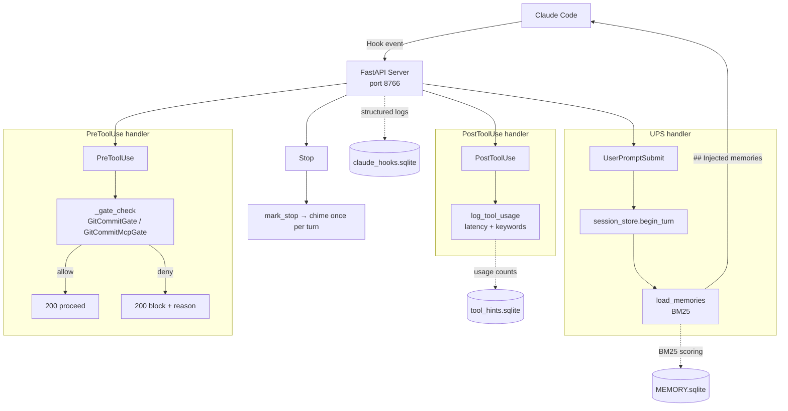

# claude-hooks Architecture

> This document describes the system as built — the decisions made, why they were made, and the constraints that shaped the design. Task tracking and the concept tools are not part of it: they live in the sibling [task-framework](https://github.com/debaditya-mohankudo/Lite-Task-Framework) project, which this repo calls (fail-open) but never the reverse.

---

## Overview

`claude-hooks` is a Python system that intercepts Claude Code hook events and handles each one in a **single orchestrator, `hooks/dispatcher.py`**, with per-session state in `hooks/session_store.py`. (A LangGraph graph with a checkpointer stood between them until task:31fb711d removed it.) Its responsibilities are:

1. **Memory injection** — score and inject relevant memories from `MEMORY.sqlite` into every prompt (BM25 over tags plus slug words, slug matches weighted higher, score lowered per noise mark in `mismatch_count`; skill-tagged memories on a `Skill` call)
2. **Commit traceability gating** — deny a `git commit` that carries no `task:<id>` reference
3. **Tool usage tracking** — accumulate latency and keyword signals per MCP tool in `tool_hints.sqlite`
4. **Observability** — structured logs in `claude_hooks.sqlite` and a rolling cross-session event log (`server_memory.sqlite`)
5. **Tool-call side effects** — the WebSearch cache, the find_cli hit-rate log, vault reindexing, the context-size nudge and skill-tagged memory injection. The dispatcher runs these inline in its handlers (see [The dispatcher](#the-dispatcher))

---

## Subsystems

- **HookServer** — FastAPI server (`hooks/server.py`, port 8766), `hooks/dispatcher.py` event handlers, the gates in `hooks/gates.py`, and the session memory timeline. Routes: `/hook/{UserPromptSubmit,PreToolUse,PostToolUse,Stop,SessionStart,SessionEnd}` plus `/health` and `/session*` read endpoints. Owns the `SessionStore` lifecycle.
- **SessionStore** — `hooks/session_store.py`: a plain per-session dict (turn, prompt, prompt_id, Stop flags), in-process, capped at 200 sessions, evicted on `SessionEnd`. Replaced the LangGraph checkpointer (`MemorySaver`, and `SqliteSaver` before it, task:b3964f85).
- **ToolHandlers** — the `handle_*` functions in `src/tools/*`: 5 domains, 23 actions (`hooks`, `memory`, `think`, `scratch`, `vault_map`). `DOMAIN_MAP` in `src/dispatcher.py` is the authoritative list. The live front-end is cli-graph's `mac hooks …` / `mac memory …`, which imports the handlers through a subprocess runner. **`mcp_server.py` is dormant, kept on purpose:** no Claude Code config connects to it (`claude-hooks` is in `disabledMcpServers`), so `hooks__*` / `memory__*` MCP tools do not exist in a session. `tests/test_src_dispatcher.py` keeps it from rotting while dormant.
- **Stores** — `MEMORY.sqlite` (memories, BM25), `tool_hints.sqlite`, `claude_hooks.sqlite` (logs), `server_memory.sqlite` (event log). `concept_store/concepts.json` holds per-module architectural facts.
- **Foundation** — config (`src/config.py`), DB schema (`src/db/schema.py`), logging. Cross-cutting, not a peer subsystem.

## The dispatcher

Ground truth: `hooks/dispatcher.py`, one handler per event (`_HANDLERS`). A new behaviour is a function called from the right handler; per-session state it needs goes in `hooks/session_store.py`.

| Event | Handler does |
| --- | --- |
| `UserPromptSubmit` | `session_store.begin_turn` (counter, `prompt_id`, resets Stop flags) → `LoadMemoriesNode` (BM25; no retrieval for prompts of five words or fewer, or for agent, cross-session and task-notification messages) → user-context render |
| `PreToolUse` | WebSearch cache check, then `_gate_check` (`hooks.gates.check`, gated tools only) |
| `PostToolUse` | side effects below, then `log_tool_usage` |
| `Stop` | `session_store.mark_stop`; the completion chime fires once per turn (`hooks/stop_effects.py`) |
| `SessionStart` / `SessionEnd` | create / evict the session's `SessionStore` entry |

The dispatcher then assembles `additionalContext` (`## Turn state`, user context, `## Injected memories`), trims it to the budget, and the response flows back to Claude Code (through `client.py`, except `PreToolUse` and `PostToolUse`, which are `http` hooks). Each side effect is fail-open:

| Event | Side effects (`hooks/dispatcher.py`) |
| --- | --- |
| `PreToolUse` | WebSearch cache: a fresh hit is returned as a deny carrying the cached result (`src/tools/web_search_cache.py`). After the gate, advisory notes only: one note per skill when its action runs without it (`hooks/skill_reminder.py`) |
| `PostToolUse` | WebSearch store, find_cli log, vault reindex (command and file-tool), context-size nudge, skill memories and skill-tag nudge — all before `log_tool_usage`. The server also links a `git commit` (`hooks/commit_link.py`) after the response is sent |

The client (`hooks/client.py`) also writes terminal state itself before the POST — kitty tab status, dashboard plan/turn and the saved last response — because its process has the session's `KITTY_*` environment. `PreToolUse` and `PostToolUse` do not go through it: they are registered as `"type": "http"`, so Claude Code POSTs straight to the server and no process starts (about 150 ms → 19 ms per tool call, measured 2026-11-27). Neither records a `hook_client` failure row. `PreToolUse` sets no kitty status. For `PostToolUse` the hook sends the session's kitty and dashboard variables as headers, and the server paints the tab and mirrors the plan (`_local_effects`), only when `X-Hooks-Local-Effects: 1` is present.

Removed, and why: the LangGraph graph (`session_graph.py`, `SessionState`, the node registry, `noop`, `play_sound`, `load_turn`, `set_prompt_id`, `gate_check`, and the unwired backfill slot with its `pluggable_nodes.md`) — its four chains held one to three trivial nodes each, while every event paid a checkpoint read, an invoke and a write (task:31fb711d). The task pipeline that sat in it earlier (`load_active_task`, `load_task_code`, `load_related_commits`, `load_related_tasks`, `load_task_history`, `summarize_task_context`, `log_task_events`, `activate_task`, `deactivate_task`) and the tool-scoring and domain-detection nodes (`score_tools`, `cwd_domain_detect`) went before it; task-framework owns active-task context.

## Gates

`hooks/gates.py` keeps two gates, both on the commit path and neither touching a task store: `GitCommitGate` (Bash — regexes the command, or a file passed via `-F`, for `task:<id>`) and `GitCommitMcpGate` (`git__commit` — requires a non-empty `task_id` param). The `imessage__send` / `mail__delete` gates moved to LocalMacMCP; the task-lifecycle gates were removed when task storage moved to task-framework.

## Requirements traceability

| Requirement | Source | Satisfied by |
| --- | --- | --- |
| Commit ↔ task traceability | concept: `gates-commit-traceability` | `HookServer` |
| Additive-only migrations | concept: `db-schema-ddl-and-migrations` invariant | `Foundation` |
| Session state non-persistence | `models/requirements.sysml` | `SessionStore` |
| Every memory is keyword-scored | concept: `memory-scoring-covers-every-row` | `Stores` |

The enforced model lives in `models/*.sysml` and is checked by `tests/test_models.py`; verify a row against `concept_store/concepts.json` before relying on it.

---

## Design Principles

- **Hooks orchestrate; MCP servers own domain logic.** Project databases stay inside MCP servers — hooks never reach across that boundary.
- **All safety decisions are deterministic and explainable.** Gate checks are rule-based, not probabilistic.
- **Fail open.** A server that is down, a gate that errors, a parse that fails — none may block the user's tool call. There is no fallback: on any error (unreachable server, 2 s timeout, a 500 from a handler) the call is allowed and nothing is injected. `client.py` gets this by printing `{}`; for the `http` tool hooks it is Claude Code's own handling of a failed request. `dispatcher.main()` is the subprocess entry point tests use, not a production path.
- **Cross-hook state lives in the server process.** `SessionStore` carries the turn and prompt fields the handlers share. Side effects keep their own small per-session dicts (e.g. the context-nudge band, the skill-memory bookkeeping in `_skill_memories.py`). Both are in-memory and lost on restart — no DB-as-IPC.
- **The dispatcher is the single orchestrator.** There is no graph to register a node in: behaviour is a function in the handler, which keeps the order of steps readable in one file (architecture review 2026-11-23, #3, decided in task:31fb711d).

---

## Design Constraints

- Low-latency execution on every hook — every millisecond is user-perceived latency
- Persistent session state across prompts without relying on Claude's in-context memory (in-process only: session state does not survive a server restart)
- No direct access to project databases — hooks only touch their own DBs
- Deterministic gate evaluation — no heuristics that can false-positive on normal prompts

---

## System Diagram

---

## Sections

- [Setup Guide](setup.md) — Getting claude-hooks running from scratch; database creation, hook registration, env vars
- [Development Workflow](dev-workflow.md) · [Testing](testing.md) · [Skills](skills.md)
